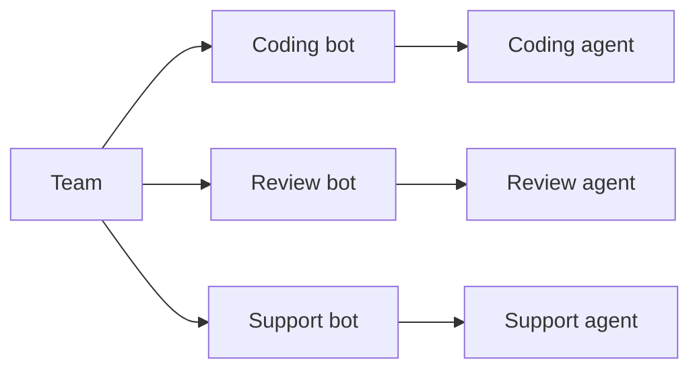
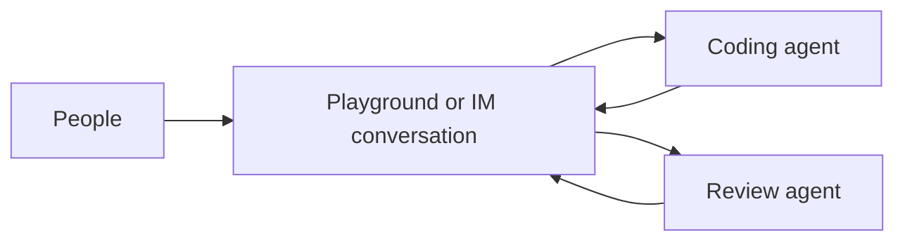
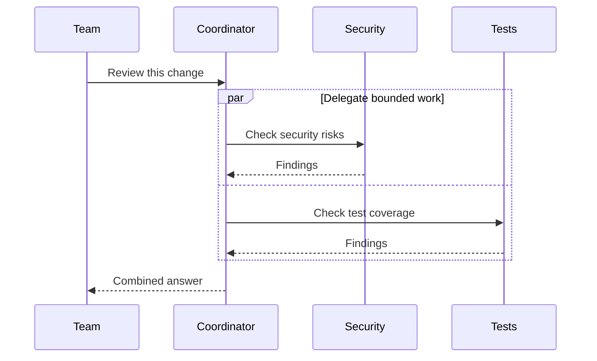
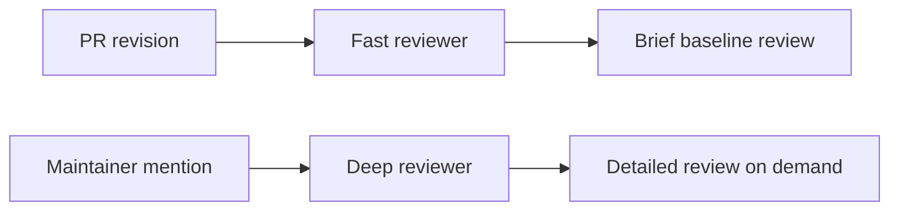
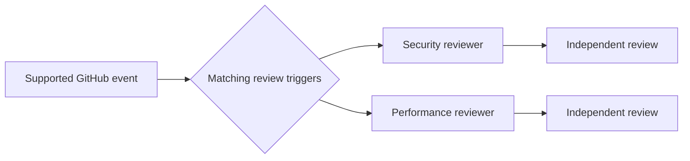
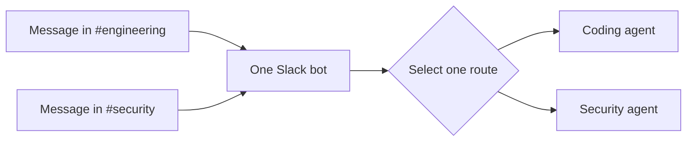

import imgPlayground from '@/public/images/playground.png'
import imgAgentTopology from '@/public/images/agent-topology.png'

AgentConnect works best when you split work across focused agents instead of trying to pack every job into one generalist. Most teams start with a few specialized agents, each connected to its own bot or integration. When people want to work with several agents at once, bring them into a shared conversation. When one agent needs to coordinate subtasks across others, enable agent-to-agent delegation.

<Image src={imgPlayground} alt="Home composer with several agents selected for one Playground conversation" width={780} />

Layered specialists are another common pattern, especially for pull-request review. Trigger fan-out and shared-bot routing are more specialized options for workflows that need parallel opinions or a single platform bot identity.

| Starting point | Work mode | Agents run | Typical use |
| --- | --- | --- | --- |
| Default | Specialized agents | One addressed agent | A role-based agent team |
| Direct collaboration | Shared conversation | Several together | Compare or collaborate live |
| Core collaboration | Agent delegation | Parent and workers | Coordinated subtasks |
| Common workflow | Layered specialists | One per request | Fast and deep PR review |
| Parallel analysis | Trigger fan-out | Several independently | Independent reviews |
| Advanced routing | Shared bot routing | One routed agent | One bot across channels |

The bot or App identity shown on a chat platform or GitHub doesn't determine which resources an agent can access. Every agent keeps its own configuration and permission boundaries in every mode.

## Specialized agents

Start with separate agents for distinct jobs such as implementation, security review, support, and release operations. A person, schedule, webhook, or integration trigger addresses the right agent directly.

Each path keeps its own integration identity, agent configuration, and session, so the agents work independently until a workflow connects them.

This setup fits roles that serve different teams or workflows whose outputs don't need to be combined. Start with [Create an agent](/build-your-team/agents/create-an-agent), then set up each agent's persona and environment under [Configure an agent](/build-your-team/agents/configure-an-agent).

## Shared conversation

For live collaboration, add multiple agents to the same Playground or IM conversation. Supported chat platforms are Slack, Telegram, Discord, and Lark / Feishu.

In Playground, a message without an explicit mention goes to every participating agent, while `@AgentName` targets only the named agents. On chat platforms, address agents using their bot identities and normal conversation trigger rules. Each agent keeps its own configuration and session while the console displays their work in one conversation.

Shared conversations are useful when people want agents to compare approaches or contribute different skills in real time. If you want one agent to coordinate others without a person steering each step, use delegation below. See [Playground](/build-your-team/agents/playground) and [Sessions](/operate-govern/sessions) for details on conversation behavior.

## Agent-to-agent delegation

With delegation, one coordinator agent assigns scoped subtasks to policy-approved worker agents. For example, a coordinator can ask separate agents to inspect security, tests, and migrations in parallel, collect their findings, and reply to the team with a single summary.

<Image src={imgAgentTopology} alt="The Agents page topology view showing every call path allowed by both agents' policies" width={900} />

Each worker runs in its own session with its own configuration and returns its findings to the coordinator, which can combine them or continue the workflow. Delegation can run directly between agents or post to a channel or thread so the team can follow the handoff.

Call permissions are checked in both directions:

1. The caller's outbound policy must allow the worker.
2. The worker's inbound policy must allow the caller.
3. Both agents must belong to the same organization.

Being in the same chat channel doesn't grant or block agent-to-agent calls. Authorization depends solely on the two policies above.

A delegated child session inherits the parent session's audience. Anyone who can read that audience can follow the child session even if the worker agent is outside their Team visibility. That access shows only the child session and a plain agent name label; it doesn't expose the worker's agent page, configuration, workspace, or controls.

Mentioning another agent's bot visibly in a chat thread can also bring that agent into the conversation under normal trigger rules, while agent visibility policies govern direct delegation.

Pick delegation when one agent should manage the overall plan and pull in specific results from specialists. See [Agent visibility](/operate-govern/permissions-overview/agent-visibility) for call policies and [Sessions](/operate-govern/sessions) for transcript and audience rules.

## Layered or on-demand specialists

A common pattern for pull-request review is pairing a fast baseline reviewer with a deeper specialist that runs only when needed. Each request still runs a single reviewer, separated by cadence and depth instead of sharing one session.

For example, a fast reviewer can inspect every PR revision automatically, while a deep reviewer runs only when an authorized maintainer mentions its AgentConnect name. Both reviewers can share one GitHub App while keeping separate models, instructions, sessions, and review output. Mentioning the App itself acts as a broadcast and can trigger all matching reviewers.

This works well when you want fast automatic coverage on every change while reserving heavier analysis for explicit requests. See [Fast PR reviews with deep review on demand](/how-to-guides/fast-and-deep-pr-reviews).

## Parallel review or trigger fan-out

When you want independent perspectives on the same event, a supported integration can dispatch that event to multiple agents at once. Each agent handles it in its own session; sharing a GitHub App doesn't merge their reasoning, permissions, or results.

GitHub PR review is the main example today. Mentioning the App runs every matching reviewer configured for the repository, while mentioning a specific agent name runs only that reviewer. Each review is attributed to its AgentConnect agent even though GitHub displays the shared App as the actor.

Fan-out has to be configured explicitly in the integration and trigger rules. Connecting multiple agents to the same repository or channel doesn't broadcast every event to all of them.

Choose trigger fan-out when separate, independent reviews are more helpful than one merged summary. If you want a single combined response, use delegation instead.

## Shared bot with contextual routing

As an advanced routing option, several agents can share a single platform bot identity while channel and thread routing picks which agent handles each inbound message. Each message runs **one agent**, so this is routing rather than broadcast collaboration.

For instance, one Slack App can route `#engineering` to a coding agent and `#security` to a review agent. Replies appear from the same Slack bot, but each AgentConnect agent keeps its own session, runtime, model, workspace, memory, tools, and permissions.

Use shared-bot routing only when your team wants a single bot identity across channels with different specialist behavior behind it. For most teams, giving each agent its own bot is simpler to understand and operate. See [One Slack app with different agents by channel](/how-to-guides/one-slack-app-across-channels).

## Cross-platform handoff is different

A single agent connected to Slack, Telegram, Discord, or Lark / Feishu can move a task between **two messaging workspaces you trust**. Because the same agent handles both sides, this is a cross-platform handoff rather than multi-agent collaboration, and the source and destination remain separate linked sessions. It works only for someone AgentConnect can identify (such as a Slack member with a linked account) and only into a conversation where that person can post.

See [Hand off conversations between trusted workspaces](/how-to-guides/hand-off-conversations-across-messaging-platforms) before moving context across platform boundaries.

## Keep the permission layers separate

Combining work modes doesn't merge their trust boundaries:

- **Platform access**: Controls which repositories, workspaces, channels, and people a bot or App can reach.
- **Team visibility**: Controls which people can find and manage an AgentConnect resource.
- **Agent visibility**: Controls which agents can call each other.
- **Session visibility**: Controls who can read a run and its transcript.
- **Runtime permissions and sandboxing**: Control what the running process can do.

See [Permissions](/operate-govern/permissions-overview) for the full model. A common combination is using contextual routing to pick the right specialist first, then using explicit delegation when that specialist needs help from another agent.
