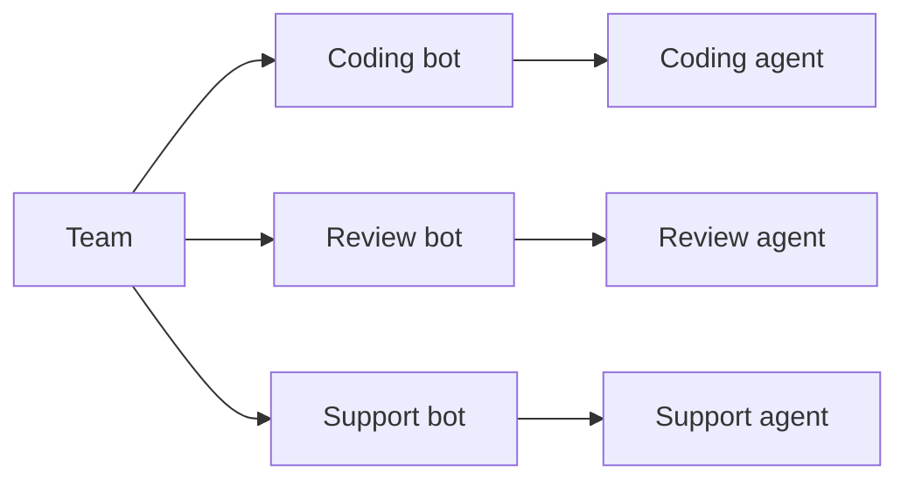
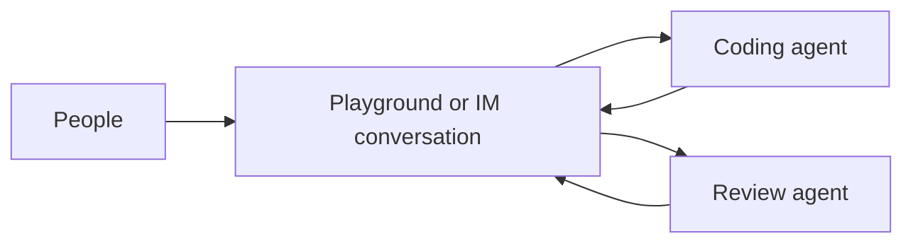
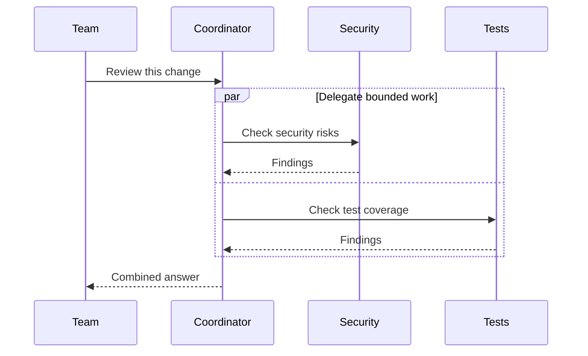
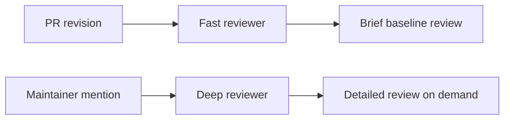
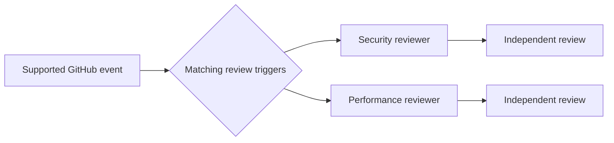
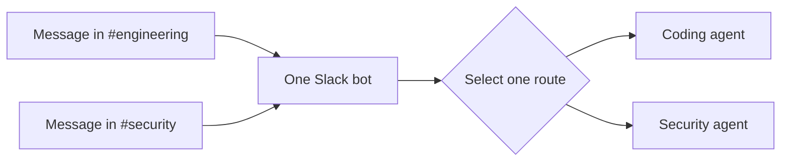

import imgPlayground from '@/public/images/playground.png'
import imgAgentTopology from '@/public/images/agent-topology.png'

在 AgentConnect 中，与其把所有职责塞进一个通用 Agent，不如拆成多个各司其职的专项 Agent。大多数团队可以从几个职责单一的 Agent 起步，每个 Agent 各自绑定独立的机器人或集成。需要同时和多个 Agent 讨论时，可以把它们拉进同一个共享对话；需要由一个 Agent 统筹并拆分子任务时，再开启 Agent 之间的委派。

<Image src={imgPlayground} alt="首页输入框中选择了多个 Agent，用于同一个 Playground 对话" width={780} />

分层专项 Agent 是另一类常见做法，尤其适合 Pull Request 评审。至于触发器扇出和共享机器人路由，则适合需要并行给出独立意见，或希望对外保持单一机器人身份的特定工作流。

| 起点 | 工作模式 | Agent 运行方式 | 典型用途 |
| --- | --- | --- | --- |
| 默认 | 专项 Agent | 单个被调用的 Agent | 按角色分工的 Agent 团队 |
| 直接协作 | 共享对话 | 多个 Agent 同时参与 | 实时对比或协同处理 |
| 核心协作 | Agent 委派 | 协调者与子 Agent | 协同拆解子任务 |
| 常见工作流 | 分层专项 Agent | 每次请求运行一个 | 快速初审 + 按需深度评审 |
| 并行分析 | 触发器扇出 | 多个 Agent 各自独立运行 | 独立视角的多维评审 |
| 高级路由 | 共享机器人路由 | 按路由命中单个 Agent | 一个机器人跨多个频道服务 |

聊天平台或 GitHub 上对外显示的机器人或 App 身份，并不决定 Agent 能访问哪些资源。无论采用哪种模式，每个 Agent 都保持各自独立的配置和权限边界。

## 专项 Agent [#specialized-agents]

先为不同职责创建独立的 Agent，例如编码实现、安全评审、技术支持和发布运维。成员、定时任务、Webhook 或集成触发器直接调用对应的 Agent。

每条链路都有独立的集成身份、Agent 配置和会话。在工作流显式把它们串起来之前，各个 Agent 互不干扰。

这种模式适合面向不同团队或流程、且输出无需合并的场景。可以先[创建 Agent](/build-your-team/agents/create-an-agent)，再在[配置 Agent](/build-your-team/agents/configure-an-agent)里为每个角色写好人设与环境配置。

## 共享对话 [#shared-conversation]

需要实时协作时，可以把多个 Agent 拉进同一个 Playground（控制台中显示为“试用”）或 IM 对话。支持的聊天平台包括 Slack、Telegram、Discord 和 Lark / 飞书。

在 Playground 中，未明确 `@` 的消息会发给所有参与对话的 Agent，而 `@AgentName` 只会触发被点名的 Agent。在聊天平台里，则通过各自的机器人身份和常规触发规则来调用。控制台会把所有参与者的回复整合在同一个对话视图里，但每个 Agent 仍维护各自独立的配置和会话。

当团队希望多个 Agent 实时对比方案或各自贡献专长时，共享对话很顺手。如果想让一个 Agent 自主协调其他 Agent，而不需要人工逐步指挥，请改用下面的委派模式。对话行为详见 [Playground](/build-your-team/agents/playground) 和[会话](/operate-govern/sessions)。

## Agent 之间的委派 [#agent-to-agent-delegation]

使用委派模式时，一个协调 Agent 可以把范围明确的子任务分派给策略允许的其他 Agent。例如，协调者可以让不同 Agent 并行检查安全风险、测试覆盖率和数据库迁移，回收结果后向团队输出一份综合结论。

<Image src={imgAgentTopology} alt="Agent 页面的拓扑视图：双方策略都允许的每一条调用路径" width={900} />

每个被调用的 Agent 都在独立会话中按自己的配置执行任务，完成后把结果返回给协调者，由协调者汇总或继续后续步骤。委派既可以在 Agent 之间直接完成，也可以在频道或线程里发出一条消息，让团队成员看到交接过程。

调用权限按方向双向校验：

1. 调用方的出站策略必须允许目标 Agent。
2. 目标 Agent 的入站策略必须允许该调用方。
3. 两个 Agent 必须属于同一个组织。

同在一个聊天频道并不会授予或阻止 Agent 之间的调用，权限完全取决于上面两条策略。

委派产生的子会话会继承父会话的可见受众。有权查看该受众的成员即使没有目标 Agent 的团队可见权限，也能查看子会话。不过他们只能看到子会话内容和一个简单的 Agent 名称标签，无法访问目标 Agent 的详情页、配置、工作区或任何操作项。

在聊天线程中直接 `@` 另一个 Agent 的机器人，也可以按常规触发规则把它拉入讨论；而 Agent 之间的直接委派则受 Agent 可见范围策略约束。

需要由一个 Agent 统筹整体方案、再按需调取专项结果时，适合使用委派模式。调用策略参见 [Agent 可见范围](/operate-govern/permissions-overview/agent-visibility)，会话记录与受众边界参见[会话](/operate-govern/sessions)。

## 分层或按需的专项 Agent [#layered-or-on-demand-specialists]

Pull Request 评审中很常见的一种做法，是把常规检查交给快速的初审 Agent，只在需要时再调用更强的深度评审 Agent。每次请求仍然只运行一个评审者，两层按触发频率和深度分工，不共享会话。

例如在 Pull Request 评审中，快速评审 Agent 可以自动检查每一次提交，而深度评审 Agent 仅在有权限的维护者 `@` 其 AgentConnect 名称时才启动。两者可以共用同一个 GitHub App，但各自保持独立的模型、指令、会话和评审结果。直接提及 App 本身相当于广播，会触发所有匹配的评审 Agent。

这种模式适合既要自动覆盖日常变更、又想把高成本分析留给手动按需触发的场景。详见[快速 PR 评审与按需深度评审](/how-to-guides/fast-and-deep-pr-reviews)。

## 并行评审或触发器扇出 [#parallel-review-or-trigger-fan-out]

如果希望从多个独立视角审视同一个事件，可以让受支持的集成把事件同时分发给多个 Agent。每个 Agent 在各自的会话中独立处理；共用一个 GitHub App 并不会合并它们的推理过程、权限或结论。

目前主要应用于 GitHub 评审：提及 App 会触发该仓库下所有匹配的评审 Agent，而提及具体 Agent 名称则只运行对应的评审者。尽管 GitHub 上显示的操作者都是同一个共享 App，但每条评审记录仍会归属到各自的 AgentConnect Agent。

扇出必须在集成和触发器配置中显式开启。把多个 Agent 绑定到同一个仓库或频道，并不会自动把所有事件广播给它们。

当你更看重多方独立意见而非一份综合回答时，选择触发器扇出；如果需要合并后的统一回复，请使用委派模式。

## 共享机器人与上下文路由 [#shared-bot-with-contextual-routing]

作为高级路由选项，多个 Agent 可以共用一个平台机器人身份，由频道和线程路由规则决定每条入站消息交给哪个 Agent 处理。每条消息只会运行 **一个 Agent**，本质上是路由分发，而不是广播协作。

例如，同一个 Slack 应用可以把 `#engineering` 路由给编码 Agent，把 `#security` 路由给安全评审 Agent。回复在 Slack 里都来自同一个机器人，但每个 AgentConnect Agent 依然使用各自独立的会话、Runtime、模型、工作区、记忆、工具和权限。

仅在希望团队只记一个机器人账号、同时不同频道需要专项能力时采用此模式。对大多数团队而言，一个 Agent 配一个独立机器人更直观，也更容易维护。详见[一个 Slack 应用按频道使用不同的 Agent](/how-to-guides/one-slack-app-across-channels)。

## 跨平台交接是另一回事 [#cross-platform-handoff-is-different]

同时接入 Slack、Telegram、Discord 或 Lark / 飞书的单个 Agent，可以把任务转移到 **你信任的另一个消息工作区** 中。因为两端都由同一个 Agent 处理，这属于跨平台交接，而非多 Agent 协作，源端和目标端仍是彼此独立但相互关联的会话。该功能仅对 AgentConnect 能识别身份的用户生效（例如已关联账号的 Slack 成员），且只能转入该用户本人有权发言的对话。

跨平台转移信息前，请先阅读[在可信工作区之间交接对话](/how-to-guides/hand-off-conversations-across-messaging-platforms)。

## 保持各层权限相互独立 [#keep-the-permission-layers-separate]

组合多种工作模式不会合并它们各自的信任边界：

- **平台访问**：控制机器人或 App 可以访问哪些仓库、工作区、频道和成员。
- **团队可见范围**：控制哪些成员能查看并管理 AgentConnect 中的资源。
- **Agent 可见范围**：控制哪些 Agent 之间可以互相调用。
- **会话可见范围**：控制谁能查看某次运行及其会话记录。
- **Runtime 权限和沙箱隔离**：控制运行中的进程可以执行哪些操作。

完整权限模型参见[权限](/operate-govern/permissions-overview)。一种常见的组合方式是：先用上下文路由把请求交给合适的专项 Agent，再在它需要协助时通过显式委派调用另一个 Agent。
