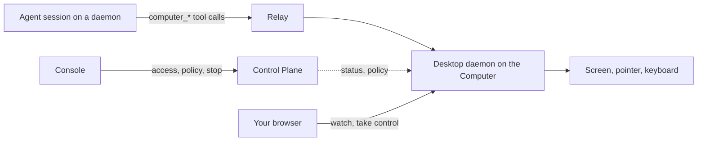

A **Computer** is a graphical desktop registered with your organization that agents can see and operate. An agent takes screenshots, clicks, types, and launches apps there through its `computer_*` tools. Use one for work a shell and a headless browser cannot do: software that only has a GUI, checking an interface by looking at it, or acting in an app where someone is already signed in.

A Computer is not a daemon. A [daemon](/build-your-team/daemons) runs agents; a Computer is used by agents. One machine can be both, or only one of them.

<Callout type="info">
The console shows Computers only where the deployment has turned the feature on. If **Infra** has no **Computers** section, it is off. On a self-hosted deployment, see [Computers for self-hosting](/self-hosting/computers) to turn it on.
</Callout>

## Kinds of computer

| Kind                  | What it is                                                                                    | Use it for                                                         |
| --------------------- | --------------------------------------------------------------------------------------------- | ------------------------------------------------------------------ |
| **Your own desktop**  | A Linux, macOS or Windows machine you are signed in to, running the desktop daemon            | The apps, files and sign-ins that exist only on that machine       |
| **Desktop container** | A Linux desktop with Chromium and LibreOffice, in a Docker container on a server you run      | Browser and office work, isolated from the server it runs on       |
| **Cloud computer**    | An isolated Linux desktop the deployment creates from its own pool, where it runs one         | Desktops made on demand, for one session, one agent, or shared     |

The first two are **self-hosted**: you [add them](/build-your-team/computers/add-a-computer) with one command. Agents use every kind the same way.

## How it works

The **desktop daemon** runs inside the signed-in graphical session and embeds the driver that captures the screen and sends input. It only dials out, so the machine needs no inbound port.

- Tool calls and screenshots travel between the agent's daemon and the desktop through the relay.
- The Control Plane handles registration, status, access and policy. It never carries screen content.
- When you watch, the video goes between your browser and the desktop, directly or through a TURN relay.

## What an agent can do

| Capability                                                         | Available                                                                |
| ------------------------------------------------------------------ | ------------------------------------------------------------------------ |
| See the screen and the pointer                                     | Always, once the agent has the computer                                  |
| Click, drag, scroll, type, press keys, launch apps                 | When the computer's policy allows control, which is the default          |
| Run commands and read or write files                               | On Linux computers, when the owner allows it; off on your own desktop    |

The tools are offered to runtimes that show the model the images a tool returns. Claude Code and Codex do. See [Let agents use a computer](/build-your-team/computers/give-agents-a-computer) for the tools, approvals and the usage policy.

## You stay in control

- **No agent can use a new computer.** Someone who can see the computer gives it to each agent.
- **The first input asks.** By default, an agent's first click or keystroke in a session waits for approval.
- **One agent at a time.** A desktop has one pointer and one keyboard, so agents take turns. On Linux, each agent gets a desktop of its own by default, so agents work in parallel.
- **The person at the machine wins.** Moving the mouse pauses agent input, and you can stop all agents from the console or from the machine.
- **Nothing is replayed.** When an action's outcome is unknown, the agent gets a fresh screenshot to check instead of a retry.
- **Everything is recorded.** A computer's **Activity** lists what agents and viewers did.

See [Watch and take over](/build-your-team/computers/watch-and-take-over).

<Callout type="warn">
Your own desktop has no isolation. An agent that controls it can do in its apps what you can, and everything on screen reaches the agent and its model provider. Treat what appears on screen as untrusted input, like any web page an agent reads. For work that does not need your own apps and sign-ins, use a desktop container or a cloud computer.
</Callout>

## Next steps

- [Add a computer](/build-your-team/computers/add-a-computer): register a desktop or a container, check its health, and remove it.
- [Let agents use a computer](/build-your-team/computers/give-agents-a-computer): give it to an agent, and set approvals, turns and the usage policy.
- [Watch and take over](/build-your-team/computers/watch-and-take-over): see the screen live, take the mouse and keyboard, stop agents, and review activity.
- [Computers for self-hosting](/self-hosting/computers): turn the feature on, run desktop containers, and configure viewer video and screenshot storage.
