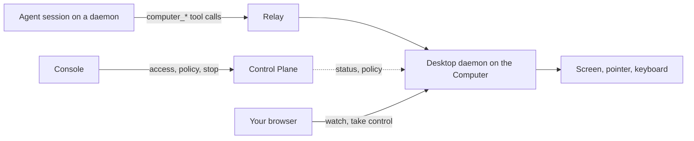

import imgComputersInfra from '@/public/images/computers-infra.png'

A **Computer** is a graphical desktop registered with your organization that agents can see and operate. An agent takes screenshots, clicks, types, and launches apps through its `computer_*` tools. Use a Computer for tasks a shell and headless browser can't handle: GUI-only software, visual UI checks, or working inside an app where someone is already signed in.

<Image src={imgComputersInfra} alt="The Infra page's Cloud computers and Computers sections: one cloud computer running, two asleep, and two self-hosted computers" width={820} />

A Computer is separate from a [daemon](/build-your-team/daemons). Daemons run agents, while agents use Computers. One machine can act as a daemon, a Computer, or both.

<Callout type="info">
The console shows Computers only when the feature is enabled for your deployment. If **Infra** doesn't have a **Computers** section, the feature is off. On a self-hosted deployment, see [Computers for self-hosting](/self-hosting/computers) to enable it.
</Callout>

## Kinds of computer

| Kind                  | What it is                                                                                       | Use it for                                                                   |
| --------------------- | ------------------------------------------------------------------------------------------------ | ---------------------------------------------------------------------------- |
| **Your own desktop**  | A Linux, macOS, or Windows machine you're signed in to, running the desktop daemon               | Apps, files, and sign-ins that exist only on that machine                    |
| **Desktop container** | A Linux desktop with Chromium and LibreOffice running in a Docker container on your own server   | Browser and office tasks isolated from the host server                       |
| **Cloud computer**    | An isolated Linux desktop created from your deployment's computer pool (when enabled)            | On-demand desktops scoped to one session, one agent, or shared across agents |

The first two are **self-hosted**: you [add them](/build-your-team/computers/add-a-computer) with a single command. Agents interact with all three kinds the same way.

## How it works

The **desktop daemon** runs inside the signed-in graphical session and includes the driver that captures the screen and sends input. It only makes outbound connections, so the machine doesn't need any inbound ports open.

- Tool calls and screenshots travel between the agent's daemon and the desktop through the relay.
- The Control Plane handles registration, status, access, and policy. Screen content never passes through it.
- When you watch a desktop, video streams between your browser and the desktop directly or through a TURN relay.

## What an agent can do

| Capability                                             | Available                                                                         |
| ------------------------------------------------------ | --------------------------------------------------------------------------------- |
| See the screen and pointer                             | Always available once the agent has access to the computer                        |
| Click, drag, scroll, type, press keys, and launch apps | When the computer's policy allows control (the default)                           |
| Run commands and read or write files                   | On Linux computers when enabled by the owner (off by default on your own desktop) |

These tools are available to runtimes that pass tool-returned images to the model, including Claude Code and Codex. See [Let agents use a computer](/build-your-team/computers/give-agents-a-computer) for the full tool list, approvals, and usage policy.

## You stay in control

- **Explicit access**: New computers aren't accessible to any agent until someone who can see the computer grants access to specific agents.
- **Approval before input**: By default, an agent's first click or keystroke in a session waits for human approval.
- **One agent at a time**: A desktop has a single pointer and keyboard, so agents take turns. On Linux, each agent gets its own virtual desktop by default so multiple agents can work in parallel.
- **Human priority**: Moving the mouse pauses agent input, and you can stop all agents from the console or directly on the machine.
- **No blind retries**: If an action's outcome is unknown, the agent gets a fresh screenshot to inspect instead of replaying the action.
- **Activity logging**: A computer's **Activity** tab logs what agents and viewers did.

See [Watch and take over](/build-your-team/computers/watch-and-take-over) for details.

<Callout type="warn">
Your own desktop has no isolation. An agent with control can do anything you can in your apps, and everything visible on screen is sent to the agent and its model provider. Treat on-screen content as untrusted input, just like any web page an agent reads. For tasks that don't need your local apps or sign-ins, use a desktop container or a cloud computer instead.
</Callout>

## Next steps

- [Add a computer](/build-your-team/computers/add-a-computer): Register a desktop or container, check its health, and remove it.
- [Let agents use a computer](/build-your-team/computers/give-agents-a-computer): Grant access to agents and configure approvals, turn-taking, and usage policies.
- [Watch and take over](/build-your-team/computers/watch-and-take-over): Watch the screen live, take over the mouse and keyboard, stop agents, and review activity.
- [Computers for self-hosting](/self-hosting/computers): Enable the feature, run desktop containers, and configure viewer video and screenshot storage.
