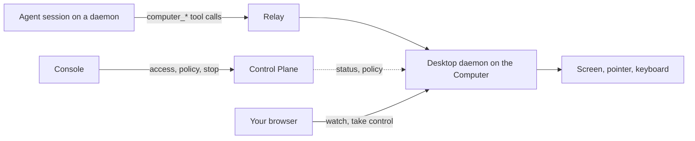

import imgComputersInfra from '@/public/images/computers-infra.png'

**Computer** 是注册到组织中的图形桌面，供 Agent 查看和操作。Agent 通过 `computer_*` 工具截屏、点击、输入文字和启动应用。遇到 shell 和无头浏览器无法胜任的场景时可以使用它，例如只有图形界面的软件、需要肉眼确认的界面检查，或在已登录的应用中执行操作。

<Image src={imgComputersInfra} alt="基础设施页面的 Cloud Computer 和 Computer 分区：一台 Cloud Computer 运行中、两台休眠，以及两台自托管 Computer" width={820} />

Computer 与 [Daemon](/build-your-team/daemons) 是两个独立的概念：Daemon 负责运行 Agent，Computer 则是供 Agent 使用的桌面环境。一台机器可以只作为其中之一，也可以同时承担两者。

<Callout type="info">
只有在部署中开启了 Computer 功能后，控制台才会显示相关入口。如果**基础设施**页面里没有 **Computer** 分区，说明该功能尚未开启。自托管部署请参阅[自托管：Computer](/self-hosting/computers) 了解如何启用。
</Callout>

## Computer 的种类 [#kinds-of-computer]

| 种类               | 说明                                                                         | 适用场景                                       |
| ------------------ | ---------------------------------------------------------------------------- | ---------------------------------------------- |
| **你自己的桌面**   | 运行桌面守护进程的已登录 Linux、macOS 或 Windows 机器                        | 仅存在于该机器上的应用、文件和登录状态         |
| **桌面容器**       | 在自管服务器上以 Docker 容器运行的 Linux 桌面，内置 Chromium 和 LibreOffice  | 与宿主机隔离的浏览器和办公任务                 |
| **Cloud Computer** | 由部署中的 Computer 池按需创建的隔离 Linux 桌面（需启用 Computer 池）        | 按需分配的桌面，可限定为单会话、单 Agent 或共享 |

前两种属于**自托管**桌面，用一条命令即可[完成添加](/build-your-team/computers/add-a-computer)。Agent 使用这三种 Computer 的方式完全一致。

## 工作原理 [#how-it-works]

**桌面守护进程**运行在已登录的图形会话中，内置负责截屏和发送输入的驱动。它只发起出站连接，因此机器无需开放任何入站端口。

- 工具调用和截图通过 Relay 在 Agent 所在的 Daemon 与桌面之间传输。
- 控制平面负责注册、状态同步、访问权限和策略管理，屏幕内容从不经过控制平面。
- 你观看桌面时，视频流在浏览器和桌面之间直连传输，或在无法直连时经由 TURN 中继转发。

## Agent 能做什么 [#what-an-agent-can-do]

| 能力                                   | 可用条件                                                       |
| -------------------------------------- | -------------------------------------------------------------- |
| 查看屏幕和鼠标指针                     | Agent 获得该 Computer 的访问权限后始终可用                     |
| 点击、拖拽、滚动、输入、按键、启动应用 | Computer 的策略允许控制时可用（默认开启）                      |
| 运行命令、读写文件                     | 仅限 Linux Computer 且需所有者开启（在你自己的桌面上默认关闭） |

这些工具仅提供给支持向模型传递工具返回图片的 Runtime，例如 Claude Code 和 Codex。关于具体工具列表、批准机制和使用策略，请参阅[让 Agent 使用 Computer](/build-your-team/computers/give-agents-a-computer)。

## 控制权在你手中 [#you-stay-in-control]

- **显式授权**：新添加的 Computer 默认不对任何 Agent 开放，需由能看到它的成员逐个授权给指定的 Agent。
- **首次输入需批准**：默认情况下，Agent 在会话中首次点击或按键前会等待人工批准。
- **单次仅限一个 Agent 控制**：每个桌面只有一个指针和键盘，因此 Agent 会轮流操作。在 Linux 上，每个 Agent 默认拥有独立的虚拟桌面，可以并行工作。
- **本机操作优先**：移动鼠标会暂停 Agent 的输入，你也可以随时在控制台或本机停止所有 Agent。
- **不盲目重试**：当某次操作的结果不确定时，系统不会重放操作，而是给 Agent 返回一张新截图以便确认。
- **全程记录**：Computer 的**活动**页会记录 Agent 和观看者的操作历史。

详见[观看与接管](/build-your-team/computers/watch-and-take-over)。

<Callout type="warn">
你自己的桌面没有任何隔离。获得控制权的 Agent 可以在你的应用中执行与你同等的操作，屏幕上显示的所有内容都会发送给 Agent 及其模型提供方。请将屏幕上的内容视为不可信输入，就像对待 Agent 读取的任何网页一样。如果任务不需要使用本地应用或登录状态，建议改用桌面容器或 Cloud Computer。
</Callout>

## 下一步 [#next-steps]

- [添加 Computer](/build-your-team/computers/add-a-computer)：注册桌面或容器、检查健康状态，以及吊销或移除。
- [让 Agent 使用 Computer](/build-your-team/computers/give-agents-a-computer)：将 Computer 授权给 Agent，配置批准规则、轮流机制和使用策略。
- [观看与接管](/build-your-team/computers/watch-and-take-over)：实时观看屏幕、接管鼠标和键盘、停止 Agent，以及查看活动记录。
- [自托管：Computer](/self-hosting/computers)：开启功能开关、运行桌面容器，以及配置观看视频和截图存储。
