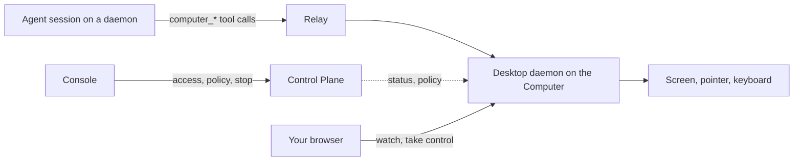

**Computer** 是注册到组织里的图形桌面，Agent 可以查看并操作它。Agent 通过 `computer_*` 工具在上面截图、点击、输入和启动应用。当 shell 和无头浏览器做不到时就用它：只有图形界面的软件、需要亲眼看界面才能确认的检查，或者要在某人已经登录的应用里操作。

Computer 不是 Daemon。[Daemon](/build-your-team/daemons) 运行 Agent；Computer 则被 Agent 使用。一台机器可以两者都是，也可以只是其中之一。

<Callout type="info">
只有在部署开启了该功能时，控制台才会显示 Computer。如果**基础设施**里没有 **Computer** 分区，说明它处于关闭状态。自托管部署请参阅[自托管：Computer](/self-hosting/computers) 来开启。
</Callout>

## Computer 的种类 [#kinds-of-computer]

| 种类           | 是什么                                                                 | 适用场景                                   |
| -------------- | ---------------------------------------------------------------------- | ------------------------------------------ |
| **你自己的桌面** | 你已登录的 Linux、macOS 或 Windows 机器，运行桌面守护进程               | 只存在于那台机器上的应用、文件和登录状态   |
| **桌面容器**   | 在你运行的服务器上，以 Docker 容器运行的带 Chromium 和 LibreOffice 的 Linux 桌面 | 浏览器和办公类工作，与所在服务器隔离       |
| **Cloud Computer**     | 部署从自己的 Computer 池创建的隔离 Linux 桌面（前提是部署运行了 Computer 池）       | 按需创建的桌面：供一个会话、一个 Agent 使用，或共享 |

前两种是**自托管**的：用一条命令就能[添加](/build-your-team/computers/add-a-computer)。Agent 使用每一种 Computer 的方式都相同。

## 工作原理 [#how-it-works]

**桌面守护进程**运行在已登录的图形会话里，内嵌负责截屏和发送输入的驱动。它只向外发起连接，所以机器不需要开放任何入站端口。

- 工具调用和截图经由 Relay 在 Agent 的 Daemon 与桌面之间传输。
- 控制平面负责注册、状态、访问权限和策略，从不传输屏幕内容。
- 你观看时，视频在你的浏览器和桌面之间传输，直连或经由 TURN 中继。

## Agent 能做什么 [#what-an-agent-can-do]

| 能力                                   | 何时可用                                                     |
| -------------------------------------- | ------------------------------------------------------------ |
| 查看屏幕和鼠标指针                     | Agent 获得这台 Computer 后始终可用                                 |
| 点击、拖拽、滚动、输入、按键、启动应用 | Computer 的策略允许控制时，这是默认设置                           |
| 运行命令、读写文件                     | 在 Linux Computer 上且所有者允许时；在你自己的桌面上默认关闭      |

这些工具只提供给会把工具返回的图片展示给模型的 Runtime，Claude Code 和 Codex 都支持。工具、批准和使用策略见[让 Agent 使用 Computer](/build-your-team/computers/give-agents-a-computer)。

## 控制权在你手中 [#you-stay-in-control]

- **新 Computer 不对任何 Agent 开放。**由能看到这台 Computer 的人逐个授予 Agent。
- **第一次输入要询问。**默认情况下，Agent 在一个会话中的第一次点击或按键要等待批准。
- **一次只有一个 Agent。**一个桌面只有一个指针和一个键盘，所以 Agent 轮流使用。在 Linux 上，每个 Agent 默认有自己的桌面，因此可以并行工作。
- **坐在机器前的人优先。**移动鼠标会暂停 Agent 的输入，你也可以从控制台或在机器上停止所有 Agent。
- **绝不重放。**当一次操作的结果未知时，Agent 会拿到一张新的截图来确认，而不是重试。
- **全程有记录。**Computer 的**活动**页列出 Agent 和观看者做过的事。

详见[观看与接管](/build-your-team/computers/watch-and-take-over)。

<Callout type="warn">
你自己的桌面没有任何隔离。控制它的 Agent 可以在你的应用里做你能做的事，屏幕上的一切都会到达 Agent 及其模型提供方。请把屏幕上出现的内容当作不可信输入，就像 Agent 读到的任何网页一样。不需要你自己的应用和登录状态的工作，请使用桌面容器或 Cloud Computer。
</Callout>

## 下一步 [#next-steps]

- [添加 Computer](/build-your-team/computers/add-a-computer)：注册桌面或容器，检查健康状况，以及移除它。
- [让 Agent 使用 Computer](/build-your-team/computers/give-agents-a-computer)：把 Computer 授予 Agent，并设置批准、轮流规则和使用策略。
- [观看与接管](/build-your-team/computers/watch-and-take-over)：实时查看屏幕、接管鼠标和键盘、停止 Agent，以及查看活动记录。
- [自托管：Computer](/self-hosting/computers)：开启该功能、运行桌面容器，并配置观看视频和截图存储。
