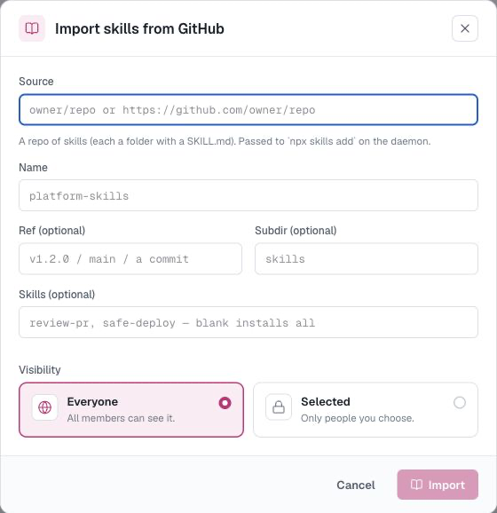

import imgToolsSkills from '@/public/images/tools-skills.png'
import imgMcpServer from '@/public/images/mcp-server.png'
import imgAgentToolsSkills from '@/public/images/agent-tools-skills.png'

**Tools & Skills** is your organization's library of capabilities that agents can use. Register an MCP provider, connector, or Git skill source once, then choose explicitly which agents get access. New agents start with an empty tool and skill allowlist.

<Image src={imgToolsSkills} alt="Organization connectors, MCP servers, and skills" width={900} />

AgentConnect separates organization-level management from per-agent enablement:

| Capability | Add or manage it | Enable it for an agent |
| --- | --- | --- |
| Connector or custom MCP server | **Tools & Skills → Connectors & MCP servers** | Agent → **Tools & Skills → Tools** |
| Git skill source | **Tools & Skills → Skills library** | Agent → **Tools & Skills → Skills** |
| Managed skill | **Knowledge → Suggestions**, then **Skills library** | Agent → **Tools & Skills → Skills** |

Adding an item to the organization library doesn't enable it for existing agents automatically.

## Connectors & MCP servers

Open **Tools & Skills** and go to **Connectors & MCP servers** to register an upstream service:

- **Add connectors**: Browse available OpenConnector providers and walk through authorization.
- **Custom MCP provider**: Connect an HTTP MCP endpoint by URL, with optional upstream headers.

<Image src={imgMcpServer} alt="Register a custom MCP server" width={520} />

Choose **Everyone** or **Selected** team visibility when adding a provider. Header values are write-only once saved, so agents can use the tool without seeing the stored credential.

A provider appears as eligible for an agent only when that agent's daemon and selected runtime support its transport. Registering a provider makes it available to select without turning it on for any agent.

Before deleting a provider, disable it on every agent that uses it.

### Add a connector

1. Open **Tools & Skills → Connectors & MCP servers** and click **Add connectors**.
2. Search the catalog or filter by category, then pick a service.
3. Choose an authorization method. API key, custom credential, and no-auth connections save immediately; OAuth opens a popup to authorize with the provider.
4. Name the connection using up to 32 letters, digits, `_`, or `-`, starting with a letter or digit. The name must be unique in your organization and can't match an MCP server name that an agent already has enabled.
5. Set its team visibility, then create the connection.

Once created, the connection behaves like any other entry in **Connectors & MCP servers** and stays off until you enable it on an agent.

When a token expires or an upstream key rotates, open the connection and click **Reconnect connector** or **Edit API key**. Because a connector's endpoint and headers are managed for you and can't be edited manually, reconnecting is how you refresh its credentials.

If a service you expect is missing from the catalog, one of two things usually applies:

- Services with built-in AgentConnect integrations (GitHub, GitLab, Linear, Slack, Telegram, Discord, and Lark / Feishu) are excluded from the connector catalog by default so you use their dedicated integrations instead.
- OAuth-only services appear once an OAuth client is configured for them in your deployment. On a self-hosted stack, see [Connector gateway](/self-hosting/connector-gateway#oauth-providers).

Services that support OAuth alongside another method remain listed either way. Only the OAuth option is hidden until its client is configured, so a service may show fewer authorization methods than the provider supports overall.

## Skills library

The Skills library holds two source types with different lifecycles:

| Source type | How it gets there | Lifecycle |
| --- | --- | --- |
| **Git skill source** | Search skills.sh or import a GitHub repository | Editable; updates reinstall enabled sources |
| **Managed skill** | An Owner accepts a suggestion | Immutable revisions; archive or restore |

Managed skills and Git sources share one library while staying clearly labeled. Adding a skill to the library doesn't enable it for any agent automatically.

### Install from skills.sh

Use the public [skills.sh](https://skills.sh) registry when you know the capability you want without knowing its repository:

1. Open **Tools & Skills → Skills library** and click **Install from skills.sh**.
2. Search by skill name and select a result.
3. Optionally rename it in your library, pick its team visibility, and click **Install**.

Each result registers only that skill from its `owner/repo` source as a regular Git skill source in your organization library, disabled until you turn it on for an agent. If the registry is unreachable, try again later or use **Import from GitHub** with a known repository.

### Import from GitHub

1. Open **Tools & Skills → Skills library** and click **Import from GitHub**.
2. Enter `owner/repo` or a GitHub repository URL. Each skill should live in its own folder with a `SKILL.md` file.
3. Optionally configure a display name, branch/tag/commit **Ref**, **Subdir**, or specific **Skills** to include. Leave **Skills** blank to import every discovered skill.
4. Set its team visibility and click **Import**.

Both registry installation and direct GitHub import support only public skill repositories today. If you set **Subdir**, also provide a **Ref** unless AgentConnect can resolve the default branch through your organization's GitHub App.

AgentConnect installs enabled skills onto the agent's daemon. Pin a tag or commit if you need identical skill versions across daemons. Before deleting a source, turn it off on every agent that uses it.

## Enable tools and skills for an agent

Open an agent and switch to its **Tools & Skills** tab.

<Image src={imgAgentToolsSkills} alt="An agent's Tools & Skills tab showing MCP servers and skill sources switched on per agent" width={820} />

Under **Tools**, enable the MCP providers this agent should access. The list combines organization-registered providers with servers reported by the agent's daemon, filtered to match the selected runtime's capabilities.

### Restrict which tools an agent can use

By default, an agent can call every tool on an enabled MCP provider. To narrow access, find the provider under **Tools** and click **Edit permissions**. Each provider shows a **Full access** or **Restricted** status.

Choose an **Access** level:

- **Full access**: Every tool is allowed, including tools the server adds later.
- **Read-only**: Read-only tools are allowed. Write/delete tools and unlabeled tools are blocked.
- **Custom**: Choose a decision for each group and override individual tools.

Tools are grouped by the labels the server publishes for them: **Read-only tools**, **Write/delete tools**, and **Other tools** for unlabeled tools. These labels are the server's own claims, so review the tools in a group before you rely on it. A tool shows **Interactive** when it renders an interface, and **Destructive** when the server says it can delete or overwrite data.

| Decision         | Effect                                                                                  |
| ---------------- | --------------------------------------------------------------------------------------- |
| **Always allow** | The agent uses the tool without asking.                                                 |
| **Blocked**      | The agent can't see or use the tool. Calls to it are refused before they reach the server. |

**Needs approval** and **Always ask** are listed but not available yet.

Permissions apply only to this agent; other agents keep their own access to the same provider. Restrictions are enforced when the agent calls a tool, not just by hiding it.

#### Keep the tool list current

The panel shows when the provider's tool list was last read and offers **Refresh list**. Saved permissions are a fixed list of tool names. Any tool the server adds later stays blocked until you review it and save again, and the panel shows a banner when the server's tools have changed since you last saved. If no tool list is available, enter tool names manually.

#### Requirements and roles

Restrictions require up-to-date daemons for the agent and up-to-date relays. The panel warns when either is outdated: an older daemon can't attach a restricted provider, and calls routed through an older relay are refused until it's upgraded.

To change permissions, you must be able to edit the agent and view the provider. Only a signed-in user can make changes, not an API key or an agent. This setting restricts the agent, not its editors: anyone who can edit the agent can also return it to **Full access**.

On a self-hosted daemon without a sandbox, agents run as the same OS user as the daemon and share its trust boundary, just as they do for other credentials.

Under **Skills**, you can:

- Enable an approved managed skill to use its current immutable revision.
- Enable an entire Git source.
- Expand a Git source and pick individual discovered skills.

Archived managed skills can't be enabled.

Under **Decisions**, attach [Decisions](/build-your-team/decisions#let-an-agent-ask) that the agent can evaluate during a turn.

### Loaded from the workspace

The agent's **Tools & Skills** tab also shows the skills its prepared workspace can actually load. Each row labels its origin as **Dream**, **Managed**, **Git source**, or **Repo**, making it easy to separate organization-managed skills from skills committed in the project repository. This live view appears once the workspace is prepared and isn't available while the daemon is offline.

## Visibility and roles

MCP providers and Git skill sources have independent [team visibility](/operate-govern/permissions-overview/team-visibility): **Everyone** or **Selected**. **Selected** grants access to the organization members you pick plus every organization Owner. At least one member must remain explicitly selected. You're selected initially when creating a resource and can remove yourself after picking someone else; Owners always keep access through their role. Collaborators can create and edit resources they can access, while Viewers have read-only access.

Approving managed skills, governing revisions, and archiving or restoring them require an organization Owner.

Team visibility determines who can find and manage a resource, while per-agent enablement determines whether that capability is exposed to the agent process. The two controls are independent.
