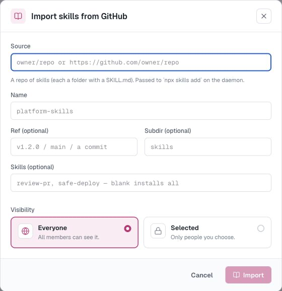

import imgToolsSkills from '@/public/images/tools-skills.png'
import imgMcpServer from '@/public/images/mcp-server.png'
import imgAgentToolsSkills from '@/public/images/agent-tools-skills.png'

**工具与技能**是组织级的能力库，用来集中管理 Agent 可以调用的工具和技能。在库中注册一次 MCP 提供方、连接器或 Git 技能源后，再按需为各个 Agent 手动开启。新建 Agent 的工具和技能白名单默认为空。

<Image src={imgToolsSkills} alt="组织的连接器、MCP 服务器和技能" width={900} />

AgentConnect 将组织级管理与单 Agent 启用拆开：

| 能力 | 添加或管理 | 为 Agent 启用 |
| --- | --- | --- |
| 连接器或自定义 MCP 服务器 | **工具与技能 → 连接器和 MCP 服务器** | Agent → **工具与技能 → 工具** |
| Git 技能来源 | **工具与技能 → 技能库** | Agent → **工具与技能 → 技能** |
| 托管技能 | **知识库 → 建议**，随后进入**技能库** | Agent → **工具与技能 → 技能** |

向组织库添加项目不会自动为任何已有 Agent 开启。

## 连接器和 MCP 服务器 [#connectors--mcp-servers]

打开**工具与技能**，进入**连接器和 MCP 服务器**注册上游能力：

- **添加连接器**：浏览可用的 OpenConnector 提供方并按引导完成授权。
- **自定义 MCP 提供方**：通过 URL 接入 HTTP MCP 端点，可按需附加上游请求头。

<Image src={imgMcpServer} alt="注册自定义 MCP 服务器" width={520} />

添加提供方时，选择**所有人**或**指定成员**作为团队可见范围。请求头的值保存后为只写状态，Agent 调用工具时不会看到已保存的原始凭证。

只有当 Agent 所在的 Daemon 和所选 Runtime 支持该提供方的传输协议时，它才会出现在该 Agent 的可选列表中。注册提供方只意味着可供选用，不会自动为任何 Agent 开启。

删除提供方之前，请先在所有启用了它的 Agent 上关闭。

### 添加连接器 [#add-a-connector]

1. 打开**工具与技能 → 连接器和 MCP 服务器**，点击**添加连接器**。
2. 搜索目录或按类别筛选，选择目标服务。
3. 选择授权方式。API 密钥、自定义凭证和无需授权的连接会立即保存；OAuth 会弹出窗口前往提供方完成授权。
4. 为连接命名（最多 32 个字符，支持字母、数字、`_` 和 `-`，且须以字母或数字开头）。名称必须在组织内唯一，且不能与任何 Agent 已启用的 MCP 服务器重名。
5. 设置团队可见范围并创建。

创建完成后，该连接与**连接器和 MCP 服务器**里的其他条目一样，默认关闭，直到你为某个 Agent 启用它。

遇到令牌过期或上游密钥轮换时，打开连接并选择**重新连接连接器**或**编辑 API 密钥**。连接器的端点和请求头由系统代管，不支持手动修改，需要通过重新连接来刷新凭证。

如果目录里找不到某个预期的服务，通常属于以下两种情况之一：

- AgentConnect 已提供原生集成的服务（GitHub、GitLab、Linear、Slack、Telegram、Discord 和 Lark / 飞书）默认不出现在连接器目录中，请直接使用它们各自的集成入口。
- 仅支持 OAuth 授权的服务，需在部署中配置好对应的 OAuth 客户端后才会出现。自托管部署请参见[连接器网关](/self-hosting/connector-gateway#oauth-providers)。

同时支持 OAuth 和其他授权方式的服务会照常列出，只是在 OAuth 客户端就绪前会隐藏 OAuth 选项，因此目录里看到的可选授权方式可能少于该服务本身支持的全部方式。

## 技能库 [#skills-library]

技能库包含两种生命周期不同的来源类型：

| 来源类型 | 如何进入技能库 | 生命周期 |
| --- | --- | --- |
| **Git 技能来源** | 搜索 skills.sh 或导入 GitHub 仓库 | 可编辑；更新后会自动重新安装已启用的来源 |
| **托管技能** | 由组织所有者接受建议 | 不可变修订版本；支持归档或恢复 |

托管技能和 Git 来源共用同一个技能库，但各自带有明确标识。向库中添加技能不会自动为任何 Agent 启用。

### 从 skills.sh 安装 [#install-from-skillssh]

如果你知道想要什么能力、但不清楚对应仓库，可以直接在公开的 [skills.sh](https://skills.sh) 注册表搜索：

1. 打开**工具与技能 → 技能库**，点击**从 skills.sh 安装**。
2. 按技能名称搜索并选中目标结果。
3. 可按需修改在库中的名称，设置团队可见范围，然后点击**安装**。

每条结果只会从其 `owner/repo` 仓库注册对应的那一个技能，以普通 Git 技能来源的形式加入组织库，默认关闭，待你为具体 Agent 启用后生效。如果注册表暂时无法访问，请稍后重试，或直接使用**从 GitHub 导入**添加已知仓库。

### 从 GitHub 导入 [#import-from-github]

1. 打开**工具与技能 → 技能库**，点击**从 GitHub 导入**。
2. 输入 `owner/repo` 或完整的 GitHub 仓库 URL。仓库中每个技能应独立存放在包含 `SKILL.md` 文件的子目录里。
3. 可按需设置显示名称、分支/标签/提交 **引用**、**子目录**，或指定要导入的**技能**列表；技能留空时会导入全部发现的技能。
4. 设置团队可见范围并点击**导入**。

目前注册表安装和 GitHub 直接导入仅支持公开仓库。如果指定了**子目录**，除非 AgentConnect 能通过组织的 GitHub App 解析仓库默认分支，否则需要同时填写**引用**。

AgentConnect 会把已启用的技能安装到对应 Agent 所在的 Daemon 上。如果希望多台 Daemon 上的内容完全一致，建议固定到某个标签或提交。删除技能来源前，请先在所有使用它的 Agent 上关闭。

## 为 Agent 启用工具和技能 [#enable-tools-and-skills-for-an-agent]

打开目标 Agent，切换到**工具与技能**标签页。

<Image src={imgAgentToolsSkills} alt="Agent 的工具与技能标签页：按 Agent 开启的 MCP 服务器和技能来源" width={820} />

在**工具**下，开启希望该 Agent 访问的 MCP 提供方。列表会合并组织已注册的提供方和该 Agent 所在 Daemon 上报的服务器，并按当前所选 Runtime 的能力过滤。

在**技能**下，你可以：

- 启用已批准的托管技能，使用其当前的不可变修订版本；
- 启用整个 Git 技能来源；
- 展开某个 Git 来源，按需勾选其中发现的单个技能。

已归档的托管技能无法启用。

在 **Decisions** 下挂载[决策](/build-your-team/decisions#let-an-agent-ask)，让 Agent 在运行轮次中自行调用评估。

### 从工作区加载 [#loaded-from-the-workspace]

Agent 的**工具与技能**标签页还会列出当前已就绪工作区中实际可加载的技能。每一行都会标明来源：**梦境**、**托管**、**Git 来源**或**仓库**，方便区分组织统一管理的能力和直接随项目代码提交的技能。这个实时列表在工作区准备完成后显示，Daemon 离线时不可用。

## 可见范围与角色 [#visibility-and-roles]

MCP 提供方和 Git 技能来源各自拥有独立的[团队可见范围](/operate-govern/permissions-overview/team-visibility)：**所有人**或**指定成员**。选择**指定成员**时，仅所选的当前组织成员以及所有组织所有者有权访问，且至少须保留一名明确选中的成员。创建时默认勾选当前用户，选中他人后可将自己移除；组织所有者始终通过角色保留访问权限。协作者可以创建和编辑自己有权访问的资源，查看者则仅具只读权限。

托管技能的批准、修订版本治理以及归档或恢复操作仅限组织所有者执行。

团队可见范围决定哪些成员能看到并管理某项资源，而单 Agent 启用开关决定这项能力是否暴露给 Agent 进程，两者相互独立。
