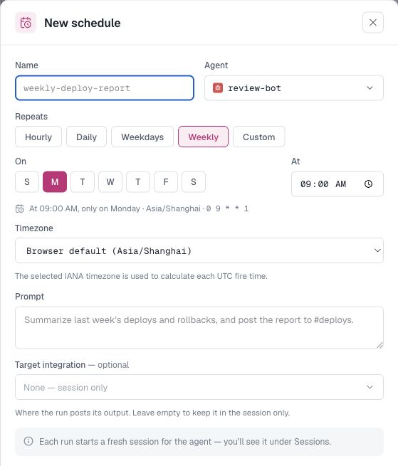

import imgSchedulesList from '@/public/images/schedules-list.png'

**Schedules** run an agent on a cron cadence, such as a daily deploy report, a nightly dependency audit, or a Monday-morning triage sweep. Each run starts a fresh session for the agent, so you can replay and inspect every run in [Sessions](/operate-govern/sessions).

## Create one

Open **Schedules → New schedule** and configure the following fields:

- **Name**: A short label, such as `weekly-deploy-report`.
- **Agent**: The agent that runs the schedule.
- **Repeats**: Pick **Hourly / Daily / Weekdays / Weekly** (with a day picker and time), or select **Custom** to enter a five-field cron expression (`0 9 * * 1`).
- **Timezone**: The IANA timezone used to evaluate the schedule, such as `America/New_York` or `Asia/Shanghai`. New schedules default to your browser's timezone, and the saved timezone still applies if the agent later moves to a daemon in another region.
- **Prompt**: The task, written the way you'd brief a person: *"Summarize last week's deploys and rollbacks, and post the report to #deploys."*
- **Target integration**: Optional. Pick one of the agent's integration channels to post the run's output there, with replies threaded underneath. Leave it on **None — session only** for a headless run that you read in Sessions.
- **Visibility**: Controls who in your organization can see the schedule ([details](/operate-govern/permissions-overview/team-visibility)).

## Run and review schedules

Use **Run now** to test a schedule without waiting for its next firing. Each run records its outcome and links directly to the corresponding session. You can also pause a schedule without deleting its configuration.

<Image src={imgSchedulesList} alt="Scheduled jobs with their cron, last run, next run, and on/off toggle" width={900} />

## Notes

- Schedules fire on the agent's daemon. If the daemon is offline at the scheduled time, that firing is skipped (check the runs list for the audit trail).
- Because each run starts a fresh session, keep the prompt self-contained. Use the agent's [memory](/build-your-team/agents/configure-an-agent) for standing context.
