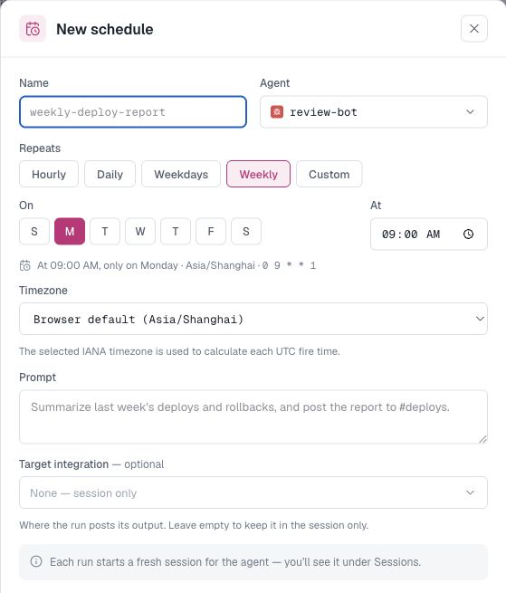

import imgSchedulesList from '@/public/images/schedules-list.png'

**定时任务**按 cron 计划运行 Agent，例如每日部署报告、夜间依赖审计或周一早上的分诊巡检。每次触发都会为 Agent 开启一个全新的会话，因此每次运行都可以在[会话](/operate-govern/sessions)中完整回放。

## 创建 [#create-one]

打开 **定时任务 → 新建定时任务** 并填写以下内容：

- **名称**：例如 `weekly-deploy-report`。
- **Agent**：负责执行该任务的 Agent。
- **重复方式**：可使用可视化选项（**每小时 / 每天 / 工作日 / 每周**，按星期和时间设置），或选择**自定义**输入五字段 cron 表达式（`0 9 * * 1`）。
- **时区**：用于计算触发时间的 IANA 时区，例如 `America/New_York` 或 `Asia/Shanghai`。新建任务默认使用你浏览器的时区；即使 Agent 后续迁移到其他区域的 Daemon，保存的时区依然生效。
- **提示词**：要执行的任务说明，像给同事交代工作一样写即可：“*总结上周的部署和回滚，并把报告发送到 #deploys。”*
- **目标集成**：可选。选择 Agent 的某个集成频道后，运行结果会发布到该频道，后续回复以线程形式挂在其下。保持**无——仅保留在会话中**则为无头运行，你可以在会话页面查看结果。
- **可见范围**：组织中哪些成员可以看到这个定时任务（[详情](/operate-govern/permissions-overview/team-visibility)）。

## 运行与查看定时任务 [#run-and-review-schedules]

点击**立即运行**即可测试定时任务，无需等待下一次触发。每次运行都会记录执行结果，并附带对应会话的链接。你也可以随时暂停定时任务，同时保留其配置。

<Image src={imgSchedulesList} alt="定时任务列表，显示各自的 cron、上次运行、下次运行和开关" width={900} />

## 说明 [#notes]

- 定时任务在 Agent 所在的 Daemon 上触发。如果在计划时间 Daemon 离线，该次触发会被跳过，运行记录列表会保留完整的审计记录。
- 由于每次运行都是全新的会话，提示词本身需要包含完整任务说明。需要长期保留的背景信息请写入 Agent 的[记忆](/build-your-team/agents/configure-an-agent)。
