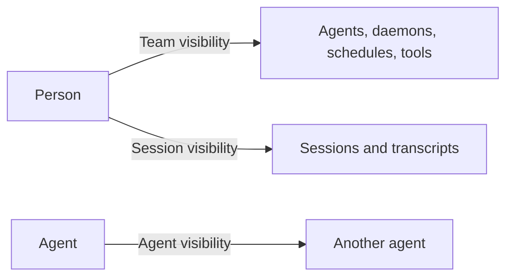

import imgAgentVisibilityDefault from '@/public/images/agent-visibility-default.png'
import imgSessionAccess from '@/public/images/session-access.png'

Everything in AgentConnect belongs to an **organization**. Membership is the outer boundary, and a member's [role](/operate-govern/permissions-overview/members-and-roles) determines what actions they can take. Inside an organization, three separate visibility controls govern access:

All three include the word *visibility*, so pay attention to the subject. Team visibility and Session visibility control what a **person** can access. Agent visibility controls which **agents** can call each other, and it grants no access to people.

None of these controls inherit from each other:

- Seeing an agent doesn't let you read its sessions.
- Reading a session doesn't grant access to the agent's page, configuration, workspace, or invocation controls. The console may display the agent's name as plain text for context, without linking to it.
- Allowing one agent to call another doesn't give either agent access to resources that a person has restricted.

## The three axes

Each control works the same way: an organization-wide default paired with a per-resource override.

| Axis | Who accesses what | Organization default | Per-resource choice |
| --- | --- | --- | --- |
| [Team visibility](/operate-govern/permissions-overview/team-visibility) | A person → an agent, daemon, schedule, MCP provider, or skill source | Everyone | **Everyone** or **Selected** |
| [Session visibility](/operate-govern/permissions-overview/session-visibility) | A person → one session and its transcript | **Session access** (off by default) | **Everyone** or **Private** (provider audiences are read-only) |
| [Agent visibility](/operate-govern/permissions-overview/agent-visibility) | An agent → another agent | **Default agent visibility** (All agents by default) | Inbound and outbound agent lists |

Organization Owners can view and edit every team resource, even if they aren't on its **Selected** list. This doesn't override [Session visibility](/operate-govern/permissions-overview/session-visibility): private and provider-restricted sessions keep their own access rules for every role.

Owners also get full [usage attribution](/operate-govern/billing-and-usage#who-sees-what) across the organization. Seeing aggregate spend doesn't grant access to the underlying sessions.

## Organization defaults

Two cards on the **Settings** page set the defaults for new agents and new sessions. Only an organization Owner can change them, making them the quickest way to set an open or closed baseline for the whole organization.

### Default agent visibility

<Image src={imgAgentVisibilityDefault} alt="The Default agent visibility card in organization settings, offering All agents or Isolated" width={760} />

This card sets the agent-to-agent policy for newly created agents:

- **All agents**: New agents can discover and call any callable agent, and accept calls from all of them. Use this when your agents work together as a single team.
- **Isolated**: New agents start as **Selected** with an empty list in both directions. They can't discover or receive calls from other agents until someone adds them. Use this when you want to allow each connection explicitly.

Changes apply only to agents created afterward. Existing agents keep their current policies, and you can still override either direction in **Add agent → Access** during creation. See [Agent visibility](/operate-govern/permissions-overview/agent-visibility).

### Session access

<Image src={imgSessionAccess} alt="The Session access card in organization settings, with one follow-platform-access toggle per platform" width={760} />

This card controls whether sessions from a platform follow that platform's own access rules instead of the standard per-origin defaults:

- **Off** (default): Each new session is **Everyone** or **Private** based on where it started. See the [default audience table](/operate-govern/permissions-overview/session-visibility#default-audience).
- **Follow Slack access**: A Slack channel or group-DM session requires a linked Slack identity in the same workspace with current access to that conversation.
- **Require GitHub access**: A private-repository session requires a linked GitHub profile with current access to that repository. Public-repository sessions remain open to every member.
- **Follow Feishu / Lark access**: Access follows current membership in the source chat, including one-to-one chats. This currently requires a self-hosted deployment.

Provider-based access is read-only on individual sessions. To change how it works, update this organization setting instead of editing a single session. Every provider check requires a matching [linked account](/how-to-guides/linked-accounts); organization membership, the Owner role, and personal API keys don't substitute for it. See [Session visibility](/operate-govern/permissions-overview/session-visibility).

Enabling Slack or Feishu / Lark access also changes who can answer approvals and update runtime settings from those chats: only the agent's editors, matched by their linked account. See [What people can do in chat](/build-your-team/agents/configure-an-agent#what-people-can-do-in-chat).

## Permissions that are separate

Several other settings use similar terms but govern different boundaries:

- An agent's **permission mode** controls what its runtime can do without asking during a run.
- [**What people can do in chat**](/build-your-team/agents/configure-an-agent#what-people-can-do-in-chat) controls whether chat participants can answer those prompts and change runtime settings. It doesn't change the permission mode itself.
- When an agent reads from or posts to a conversation outside the one it's replying in, access follows the person who made the request. The agent can only reach conversations that person could read or post in themselves. See [Reading and posting in other conversations](/connect-automate/integrations-overview#reading-and-posting-in-other-conversations).
- [Sandboxing](/operate-govern/sandboxing) isolates the runtime inside a Linux OS boundary and restricts its filesystem access.
- A workspace's **repository access** controls whether the agent gets Read only or Read & write access through the GitHub App.
- Platform app scopes control what a Slack, Discord, Telegram, Lark, or GitHub app can do on that platform.
- Tool, skill, secret, and daemon settings control which capabilities are exposed to the agent process.

These settings layer on top of the visibility controls above. Seeing an agent in the console doesn't give you write access to its repository, and letting two agents call each other doesn't expose restricted team resources.

## A useful rule of thumb

Use roles for broad responsibility, Team visibility for access to team resources, Session visibility for transcript privacy, and Agent visibility for the agent-to-agent call graph. Treat an agent and its sessions as two separate authorization targets.
