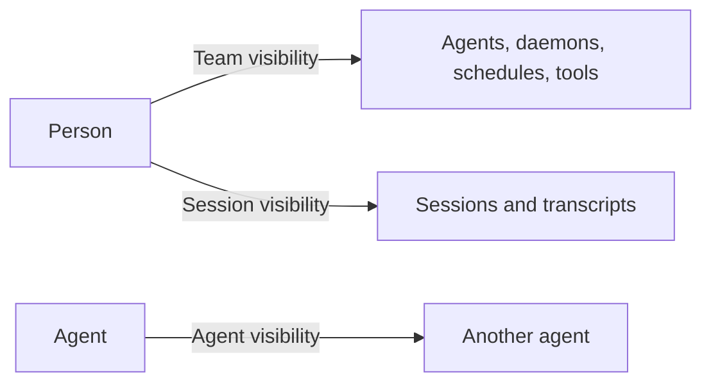

import imgAgentVisibilityDefault from '@/public/images/agent-visibility-default.png'
import imgSessionAccess from '@/public/images/session-access.png'

AgentConnect 中的所有内容都归属于**组织**。成员资格是第一道边界，成员的[角色](/operate-govern/permissions-overview/members-and-roles)决定他们能执行哪些操作。在组织内部，访问权限由三项独立的可见范围控制：

这三项配置都带有“可见范围”字样，但生效对象不同。团队可见范围和会话可见范围控制**人**能访问什么；Agent 可见范围控制哪些 **Agent** 可以相互调用，不会影响任何人的访问权限。

这三项控制彼此独立，没有继承关系：

- 能查看某个 Agent，不代表能自动读取它的会话。
- 能读取某个会话，不代表能访问对应 Agent 的详情页、配置、工作区或调用控件。控制台可能会以纯文本展示 Agent 名称作为上下文，但不会提供跳转链接。
- 允许一个 Agent 调用另一个 Agent，不会让任何一方访问被人员限制的团队资源。

## 三项可见范围 [#the-three-axes]

这三项控制的机制一致：都有一个组织级默认值，也支持针对单个资源进行覆盖。

| 维度 | 控制范围 | 组织默认值 | 单资源配置 |
| --- | --- | --- | --- |
| [团队可见范围](/operate-govern/permissions-overview/team-visibility) | 人 → Agent、Daemon、定时任务、MCP 提供方或技能来源 | 所有人 | **所有人**或**指定成员** |
| [会话可见范围](/operate-govern/permissions-overview/session-visibility) | 人 → 单个会话及其会话记录 | **会话访问权限**（默认关闭） | **所有人**或**私密**（平台同步的权限为只读） |
| [Agent 可见范围](/operate-govern/permissions-overview/agent-visibility) | Agent → 另一个 Agent | **默认 Agent 可见性**（默认为所有 Agent） | 入站和出站 Agent 列表 |

组织所有者可以查看和编辑所有团队资源，即使自己不在某项资源的**指定成员**列表中也是如此。但这一权限不会覆盖[会话可见范围](/operate-govern/permissions-overview/session-visibility)：私密会话和受平台权限限制的会话对所有角色一视同仁。

所有者还可以查看全组织完整的[用量归属](/operate-govern/billing-and-usage#who-sees-what)。看到汇总费用并不意味着能访问背后的具体会话。

## 组织默认值 [#organization-defaults]

**设置**页面上的两张卡片决定了新建 Agent 和新会话的默认权限。只有组织所有者可以修改这两项配置，它们也是为整个组织快速设定开放或封闭基线的最直接方式。

### 默认 Agent 可见性 [#default-agent-visibility]

<Image src={imgAgentVisibilityDefault} alt="组织设置中的“默认 Agent 可见性”卡片，提供“所有 Agent”或“隔离”两个选项" width={760} />

这张卡片决定新建 Agent 默认使用的相互调用策略：

- **所有 Agent**：新建 Agent 可以发现并调用其他可被调用的 Agent，也接受它们的调用。适合多个 Agent 作为一个团队协同工作的场景。
- **隔离**：新建 Agent 在入站和出站两个方向上默认都是**已选择**且列表为空。在有人手动添加之前，它既不会发现其他 Agent，也不会接受任何调用。适合需要逐条明确配置调用关系的场景。

修改此设置只对之后新建的 Agent 生效，不会改动已有 Agent 的策略。创建时仍然可以在**添加 Agent → 访问权限**中单独覆盖任一方向。详见 [Agent 可见范围](/operate-govern/permissions-overview/agent-visibility)。

### 会话访问权限 [#session-access]

<Image src={imgSessionAccess} alt="组织设置中的“会话访问权限”卡片，每个平台各有一个“遵循平台访问权限”开关" width={760} />

这张卡片决定来自某个平台的会话是否直接遵循该平台的访问权限，而不是使用常规的按来源默认规则：

- **关闭**（默认）：每个新会话根据其发起位置默认设为**所有人**或**私密**。详见[默认可见范围表](/operate-govern/permissions-overview/session-visibility#default-audience)。
- **遵循 Slack 访问权限**：Slack 频道或群组私信产生的会话，要求用户关联同一工作区的 Slack 账号，且当前有权访问原对话。
- **要求 GitHub 访问权限**：私有仓库产生的会话，要求用户关联 GitHub 账号且当前对该仓库有访问权限。公开仓库的会话仍对组织内所有成员开放。
- **遵循飞书 / Lark 访问权限**：会话访问权限跟随原聊天的当前成员名单，包括单聊。此功能目前需要自托管部署。

由平台同步而来的访问权限在单个会话上是只读的，如需调整请修改这里的组织设置，而不是去改动单个会话。所有平台权限校验都需要匹配的[关联账号](/how-to-guides/linked-accounts)；组织成员资格、所有者角色和个人 API 密钥都不能替代它。详见[会话可见范围](/operate-govern/permissions-overview/session-visibility)。

开启 Slack 或飞书 / Lark 访问权限后，在这些对话中能够响应审批、修改 Runtime 设置的人员范围也会随之收紧，仅限通过关联账号识别出的 Agent 编辑者。详见[聊天中可以做什么](/build-your-team/agents/configure-an-agent#what-people-can-do-in-chat)。

## 相互独立的权限 [#permissions-that-are-separate]

还有几项配置名称相近，但控制的是不同的边界：

- Agent 的**权限模式**控制其 Runtime 在执行过程中无需询问就能执行哪些操作。
- Agent 的[**聊天中可以做什么**](/build-your-team/agents/configure-an-agent#what-people-can-do-in-chat)控制对话中的人是否可以响应这些审批请求或修改 Runtime 设置，不会改变权限模式本身。
- Agent 在当前回复的对话之外读取消息或发送消息时，权限跟随提问者：只能访问提问者本人有权读取或发言的对话。详见[在其他对话中读取和发消息](/connect-automate/integrations-overview#reading-and-posting-in-other-conversations)。
- [沙箱隔离](/operate-govern/sandboxing)将 Runtime 隔离在 Linux 操作系统边界内，并限制其文件系统访问。
- 工作区的**仓库访问权限**控制 Agent 通过 GitHub App 获得的是只读权限还是读写权限。
- 平台应用的权限范围控制 Slack、Discord、Telegram、Lark 或 GitHub 应用在对应平台上的能力边界。
- 工具、技能、密钥和 Daemon 配置决定哪些能力会注入到 Agent 进程中。

这些配置会与上面的可见范围叠加生效。在控制台里能看到某个 Agent，并不等于拥有其代码仓库的写权限；允许两个 Agent 相互调用，也不会把受限的团队资源暴露给对方。

## 一条实用的经验法则 [#a-useful-rule-of-thumb]

用角色划分整体职责，用团队可见范围管理资源的直接访问，用会话可见范围保护会话记录隐私，用 Agent 可见范围控制 Agent 之间的调用关系。记住把 Agent 和它产生的会话当作两个独立的授权对象来看待。
