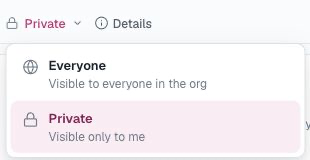

import imgSessionAccess from '@/public/images/session-access.png'

Every session has its own audience, evaluated independently from the [Team visibility](/operate-govern/permissions-overview/team-visibility) of the Agent that ran it:

- **Everyone**: Every organization member.
- **Private**: Only the person matched as the session owner.
- **Slack members**: People whose linked Slack identity has access to the source conversation.
- **GitHub members**: People with access to the source repository.
- **Feishu / Lark members**: People whose linked regional identity belongs to the source chat.

Having access to a session lets you view only that session's metadata, transcript, tool details, linked sessions, and live updates. It doesn't grant access to the owning Agent's page, configuration, workspace, or run controls. If you can read a session for an Agent outside your Team visibility, the console shows the Agent's name as plain text and a filter label without linking to the Agent page.

If you talk to an agent from another platform (or through one of its other bots) and haven't linked an account for the destination workspace, the same visibility rules control where it can read or post on your behalf: only in conversations whose sessions you can open. See [Reading and posting in other conversations](/connect-automate/integrations-overview#reading-and-posting-in-other-conversations).

## Default audience

| Session origin | Default |
| --- | --- |
| Playground, webchat, or Web API | Private |
| Webchat or Web API from a [service account](/operate-govern/permissions-overview/members-and-roles#service-accounts) | Everyone |
| One-to-one direct message | Everyone; Private while the organization follows that platform's [session access](#session-access) |
| Shared chat conversation | Everyone |
| GitHub issue or pull request | Everyone |
| Schedule, webhook, or other automation | Everyone |
| Delegated agent work | Inherits the source session |

If your organization enables provider-based access below, new sessions from that provider use the matching read-only provider audience instead of these defaults.

## Session access

You'll find **Session access** on its own card on the **Settings** page. An Owner can enable it per platform so sessions follow that platform's native access rules instead of the defaults above.

<Image src={imgSessionAccess} alt="Settings → Session access, with a follow-platform-access toggle per platform" width={760} />

Every provider check requires a matching [linked account](/how-to-guides/linked-accounts). Organization membership, the Owner role, a personal API key, or an account from another provider won't satisfy it. The owning Agent's Team visibility isn't involved either: if your linked account passes the provider check, you can open the session even when the Agent itself isn't visible to you.

### Follow Slack access

A Slack channel or group-DM session requires a linked identity from the same Slack workspace and current Slack access to the source conversation.

Active full members can read public-channel sessions without joining the channel. Private channels and group DMs require current membership. Guests and Slack Connect users must also be current members of the conversation. One-to-one Slack DMs stay Private.

When this setting is enabled, only the agent's editors can respond to approvals or change runtime settings from Slack. See [What people can do in chat](/build-your-team/agents/configure-an-agent#what-people-can-do-in-chat).

### Require GitHub access [#follow-github-access]

Sessions from public repositories remain visible to every organization member. Sessions from private repositories require a linked GitHub account that currently has access to that repository.

Linking GitHub doesn't install the GitHub App or grant repository permissions. It only provides the identity used for the access check.

### Follow Feishu / Lark access

Session visibility follows current membership in the source chat, including one-to-one chats. AgentConnect checks membership through the bot App installed in that chat. When this setting is enabled, only the agent's editors can respond to approvals or change runtime settings from these chats.

Lark and Feishu bot integrations work on AgentConnect Cloud. Social sign-in and this setting currently require a self-hosted deployment with a matching regional Login App and a linked identity that exposes the provider's `union_id`. The regional Login App restricts admitted bot Apps to the same trusted workspace (their App IDs don't need to match). See [Sign-in](/self-hosting/sign-in#lark-and-feishu-identities) for the self-hosted setup.

## Private sessions

A Private session is visible only to its matched owner. Organization Owners can't override this.

For directly managed sessions, the owner can switch between **Everyone** and **Private** in the session header. Viewers can change visibility on sessions they own, while Owners can't change visibility on someone else's session. Switching a source session to Private also restricts any delegated sessions started from it.

Provider-bound sessions have a read-only audience. To change how they're shared, update the organization's **Session access** setting instead of trying to change an individual session.

Sessions don't currently support a Selected member list or public share links.

## Delegated and handoff sessions

An [agent-to-agent](/operate-govern/permissions-overview/agent-visibility) child session inherits its parent session's visibility because the handoff can carry source context into the child's transcript. Anyone who can access the parent session can follow the child session, even if the target Agent is outside their Team visibility. In that case, the target Agent's name appears as plain text, and its page, workspace, and controls remain inaccessible.

Switching a source session to Private also switches all of its descendant sessions to Private. Widening a source session back to Everyone doesn't automatically widen a child session that was already narrowed.

## When a session link is unavailable

AgentConnect returns the same unavailable response whether a session doesn't exist, was deleted, or falls outside your access, so links don't reveal whether a protected session exists. For a provider-restricted session, check that your matching social account is linked and still has access to the source conversation or repository. Having a hidden owning Agent won't block access to an otherwise readable session.

## Usage and transcript access

Organization Owners can see full [Analytics](/operate-govern/billing-and-usage#who-sees-what) totals, agent and model breakdowns, and spend over time, including usage from Private and provider-restricted sessions. These aggregates don't expose session IDs, titles, transcripts, or tool details, and they don't make restricted sessions appear in the session list or open via a direct link.

Collaborators and Viewers see attribution only for Agents and Sessions they can access. Usage from restricted sessions stays in the organization total and the **Restricted usage** rollup.

## Memory caveat

With AgentConnect-managed memory or supported external memory, switching an Everyone session to Private stops future shared-memory capture once the daemon applies the change. Anything already captured while the session was visible to Everyone remains stored.

Provider visibility alone doesn't stop a session from capturing or recalling shared memory, and a Private session can still recall existing agent-scoped memory. Runtime-native memory has no per-session AgentConnect gate, so a private transcript can still influence what that runtime recalls later.

## AgentConnect OSS

In AgentConnect OSS, these checks require optional OIDC sign-in and provider identity lookup. Slack also requires workspace and conversation access checks, GitHub requires repository checks, and Lark / Feishu require a regional Login App, a `union_id` in the linked identity, and bot membership permissions. See [Sign-in](/self-hosting/sign-in).
