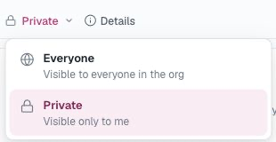

import imgSessionAccess from '@/public/images/session-access.png'

每个会话都有独立的可见范围，不受运行该会话的 Agent 的[团队可见范围](/operate-govern/permissions-overview/team-visibility)影响：

- **所有人**：组织内的所有成员。
- **私密**：仅匹配为该会话所有者的人。
- **Slack 成员**：已关联 Slack 账号且有权访问源对话的成员。
- **GitHub 成员**：有权访问源仓库的成员。
- **飞书 / Lark 成员**：已关联对应区域账号且属于源聊天的成员。

有权查看某个会话，仅意味着你可以阅读该会话的元数据、对话记录、工具详情、关联会话和实时更新，并不会授予该 Agent 的详情页、配置、工作区或运行控制权限。如果你能查看某个会话，但对应的 Agent 不在你的团队可见范围内，控制台只会把 Agent 名称展示为纯文本和筛选标签，不提供跳转链接。

当你从另一个平台（或通过 Agent 的另一个机器人）发起提问，且没有关联目标工作区的账号时，Agent 能在哪些对话里替你读取或发送消息，同样由会话可见范围决定：仅限你能打开对应会话的对话。详情见[在其他对话中读取和发消息](/connect-automate/integrations-overview#reading-and-posting-in-other-conversations)。

## 默认可见范围 [#default-audience]

| 会话来源 | 默认值 |
| --- | --- |
| Playground（控制台中显示为“试用”）、webchat 或 Web API | 私密 |
| [服务账号](/operate-govern/permissions-overview/members-and-roles#service-accounts)的 webchat 或 Web API | 所有人 |
| 一对一私信 | 所有人；若组织对该平台开启了[会话访问权限](#session-access)，则为私密 |
| 共享的聊天对话 | 所有人 |
| GitHub Issue 或 Pull Request | 所有人 |
| 定时任务、Webhook 或其他自动化 | 所有人 |
| 委派的 Agent 工作 | 继承源会话 |

当组织启用了下文的平台访问权限控制后，来自对应平台的新会话会直接使用只读的平台可见范围，覆盖上述默认值。

## 会话访问权限 [#session-access]

**会话访问权限**是组织级设置，在**设置**页面中有独立卡片。所有者可以按平台开启，让会话遵循原平台自身的访问规则，而不再使用上表的默认规则。

<Image src={imgSessionAccess} alt="设置 → 会话访问权限，每个平台各有一个“遵循平台访问权限”开关" width={760} />

每项平台检查都需要用户先绑定对应的[关联账号](/how-to-guides/linked-accounts)。组织成员身份、所有者角色、个人 API 密钥或其他平台的账号都无法替代。Agent 的团队可见范围也不参与这项检查：只要你的关联账号通过了平台权限校验，即使该 Agent 本身对你不可见，你依然可以打开对应会话。

### 遵循 Slack 访问权限 [#follow-slack-access]

查看 Slack 频道或群组私信产生的会话，需要关联同一个 Slack 工作区的账号，并且当前在 Slack 中有权访问该对话。

活跃的正式成员无需加入频道即可查看公开频道的会话。私密频道、群组私信，以及访客和 Slack Connect 用户，都必须当前在对应对话中才可查看。一对一 Slack 私信则保持私密。

开启此项后，只有该 Agent 的编辑者才能在 Slack 中处理审批或调整 Runtime 设置。详情见[聊天中可以做什么](/build-your-team/agents/configure-an-agent#what-people-can-do-in-chat)。

### 要求 GitHub 访问权限 [#follow-github-access]

公开仓库的会话对组织内所有成员保持可见。私有仓库的会话要求用户关联了 GitHub 账号，且该账号当前拥有对应仓库的访问权限。

关联 GitHub 账号不会安装 GitHub App，也不会赋予仓库操作权限，只用于权限校验时识别身份。

### 遵循飞书 / Lark 访问权限 [#follow-feishu--lark-access]

会话可见范围与源聊天的当前成员保持一致，包括一对一聊天。AgentConnect 会通过该聊天中已安装的机器人应用来校验成员身份。开启此项后，只有该 Agent 的编辑者才能在这些聊天中处理审批或调整 Runtime 设置。

Lark 和飞书机器人集成已支持 AgentConnect Cloud。社交登录和本项设置目前需要自托管部署，并配置对应的区域 Login App 以及能返回 `union_id` 的关联身份。区域 Login App 会把允许接入的机器人应用限定在同一个受信任的工作区内（各机器人的 App ID 无需一致）。自托管配置方式见[登录](/self-hosting/sign-in#lark-and-feishu-identities)。

## 私密会话 [#private-sessions]

私密会话仅对匹配到的所有者可见，组织所有者也没有权限绕过。

对于直接管理的会话，所有者可以在会话页头切换**所有人**和**私密**。查看者可以修改自己名下会话的可见范围，而组织所有者也无权修改他人会话的可见范围。将源会话设为私密后，从它派生的委派会话也会同步收紧。

绑定外部平台的会话，其可见范围为只读。如需调整共享方式，请修改组织的**会话访问权限**设置，无法单独修改某条会话的可见范围。

会话目前不支持指定成员列表，也不支持公开分享链接。

## 委派与交接会话 [#delegated-and-handoff-sessions]

[Agent 之间](/operate-govern/permissions-overview/agent-visibility)派生的子会话会继承父会话的可见范围，因为交接过程可能将源对话上下文带入子会话记录。只要有权访问父会话，就可以跟进子会话，即使目标 Agent 不在你的团队可见范围内。此时目标 Agent 名称会显示为纯文本，其页面、工作区和控件依然不可访问。

将源会话收紧为私密，会一并收紧其下所有衍生子会话。反过来，将源会话放宽为所有人可见，不会自动放宽已被单独收紧的子会话。

## 当会话链接不可用时 [#when-a-session-link-is-unavailable]

无论会话是不存在、已被删除，还是超出你的访问权限，AgentConnect 都会返回相同的“不可用”提示，避免暴露受保护会话是否存在。如果受平台权限限制的会话无法打开，请确认已关联对应的社交账号，且该账号目前仍有权访问源对话或仓库。所属 Agent 对你不可见本身，不会影响你打开有权阅读的会话。

## 用量与会话记录访问 [#usage-and-transcript-access]

组织所有者可以查看完整的[分析](/operate-govern/billing-and-usage#who-sees-what)总量、按 Agent 和模型的明细以及随时间变化的费用，包括私密会话和受平台限制的会话产生的用量。这些汇总数据不会泄露会话 ID、标题、对话记录或工具详情，也不会让这些受限会话出现在会话列表中或通过直链打开。

协作者和查看者只能看到自己有权访问的 Agent 和会话的用量归属。其余受限会话的用量会保留在组织总量以及**受限用量**汇总项中。

## 记忆注意事项 [#memory-caveat]

使用 AgentConnect 托管记忆或受支持的外部记忆时，把原本对所有人可见的会话改为私密，Daemon 应用变更后会停止后续的共享记忆捕获，但此前在公开状态下已经捕获的信息不会被删除。

仅设置平台可见范围，并不会阻止会话捕获或召回共享记忆；私密会话也依然可以召回已有的 Agent 级记忆。Runtime 原生记忆没有 AgentConnect 的按会话门控，因此私密会话记录仍可能影响该 Runtime 后续的召回结果。

## AgentConnect OSS [#agentconnect-oss]

在 AgentConnect OSS 中，上述权限检查依赖可选的 OIDC 登录和外部平台身份查询功能。此外，Slack 需要工作区和对话访问校验，GitHub 需要仓库权限校验，Lark 和飞书需要区域 Login App、关联身份中的 `union_id` 以及机器人成员读取权限。详情见[登录](/self-hosting/sign-in)。
